 

  

 

<code>DevOps / Infrastructure Engineering • Full-Stack Development • Automation</code>

  

Building, deploying, securing and observing systems — from application code to production infrastructure.

  

### `⟨ core stack ⟩`

 

<code>k8s · gitops · infrastructure as code · ci/cd · distributed systems · observability · security · full stack</code>

  

### `⟨ systems i've worked with ⟩`

<table>
<tr><td width="28%"><b>Infrastructure & orchestration</b></td><td>Kubernetes (RKE2, EKS), Rancher, Helm, Docker, Docker Compose, containerd, Terraform, Terragrunt, Ansible, Linux, bare metal, VPS</td></tr>
<tr><td><b>Cloud & delivery</b></td><td>AWS, Google Cloud (Cloud Run, Artifact Registry), GitHub Actions, GitLab CI, Bitbucket Pipelines, Jenkins, Argo CD, Argo Workflows, Fleet, GitOps, CI/CD</td></tr>
<tr><td><b>Backend & APIs</b></td><td>TypeScript, JavaScript, Python, PHP, Node.js, Express, Flask, Laravel, REST, GraphQL, WebSockets, API integrations</td></tr>
<tr><td><b>Frontend & mobile</b></td><td>React, Next.js, React Native, Expo, Redux Toolkit, Vite, HTML, CSS</td></tr>
<tr><td><b>Databases & messaging</b></td><td>PostgreSQL, MySQL, MongoDB, Redis, ClickHouse, Percona XtraDB Cluster (PXC), ProxySQL, RabbitMQ</td></tr>
<tr><td><b>Observability</b></td><td>Prometheus, Grafana, Loki, Tempo, Mimir, OpenTelemetry, Alertmanager, Zabbix; metrics, logs, tracing, alerting</td></tr>
<tr><td><b>Networking & edge</b></td><td>Nginx, HAProxy, Traefik, Cloudflare, DNS, TLS, reverse proxies, load balancing, WAF, rate limiting, bot / DDoS mitigation</td></tr>
<tr><td><b>Security & reliability</b></td><td>HashiCorp Vault, secrets management, RBAC, SSO, network isolation, high availability, failover, disaster recovery, backups, migrations, low-downtime deployments</td></tr>
<tr><td><b>Automation & tooling</b></td><td>Bash, Python scripting, web scraping, browser automation, data processing, Git, Postman, Swagger / OpenAPI, Jest, VS Code</td></tr>
<tr><td><b>CMS & e-commerce</b></td><td>WordPress, Magento, OpenCart</td></tr>
</table>

### `⟨ selected builds ⟩`

<table>
<tr>
<td width="50%" valign="top">
<b>01 // E-commerce Event Analytics</b>  
TypeScript SDK → Node.js / Express API → MongoDB → Next.js analytics dashboard.  
Event ingestion, API-key authentication, event filtering, metrics aggregation and business analytics. Multi-service Docker setup managed with Terraform.  
<code>TypeScript · Express · MongoDB · Next.js · Docker · Terraform</code>
</td>
<td width="50%" valign="top">
<b>02 // TierTracker</b>  
Pet-tracking application ecosystem with a React Native / Expo mobile app, Node.js / MongoDB API and Next.js editor.  
Firebase authentication, cloud services, gamification features, container builds and Google Cloud deployment workflows.  
<code>React Native · Expo · Node.js · MongoDB · Next.js · Firebase · GCP</code>
</td>
</tr>
</table>

<code>⟨ engineering focus / expand ⟩</code>

 

<strong>Platform engineering:</strong> Kubernetes operations, infrastructure provisioning, GitOps, reproducible environments, hybrid and cloud deployments.  
<strong>Reliability:</strong> high availability, failover, backup and recovery strategies, multi-region architecture, performance tuning and production troubleshooting.  
<strong>Observability:</strong> telemetry pipelines, service metrics, centralized logs, distributed tracing and actionable alerts.  
<strong>Application engineering:</strong> frontend-to-backend delivery, API architecture, event collection, data processing, integrations and automation.  
<strong>Infrastructure security:</strong> secrets management, access control, traffic filtering, edge protection and service isolation.

 

### `⟨ telemetry ⟩`

### `⟨ the crimson snake eats my commits ⟩`

<picture>
  <source media="(prefers-color-scheme: dark)" srcset="https://raw.githubusercontent.com/31CRIMSON/31CRIMSON/output/snake-dark.svg" />
  <source media="(prefers-color-scheme: light)" srcset="https://raw.githubusercontent.com/31CRIMSON/31CRIMSON/output/snake-light.svg" />
  
</picture>

 

<code>// end of transmission · 31CRIMSON</code>

