 

  

### `⟨ arsenal ⟩`

### `⟨ telemetry ⟩`

### `⟨ the crimson snake eats my commits ⟩`

<picture>
  <source media="(prefers-color-scheme: dark)" srcset="https://raw.githubusercontent.com/31CRIMSON/31CRIMSON/output/snake-dark.svg" />
  <source media="(prefers-color-scheme: light)" srcset="https://raw.githubusercontent.com/31CRIMSON/31CRIMSON/output/snake-light.svg" />
  
</picture>

 

<code>// end of transmission · 31CRIMSON</code>

