 

&nbsp;
&nbsp;
&nbsp;

  

  

<code>DevOps / Infrastructure</code> · <code>Cloud</code> · <code>Backend</code> · <code>Full-Stack</code> · <code>Automation &amp; CI/CD</code> · <code>Observability &amp; Security</code>

  

Building, deploying, securing and observing systems — from application code to production infrastructure. 
Open to remote projects, freelance and small commercial tasks: DevOps, backend, automation, API integrations, web services.

  

### `⟨ core stack ⟩`

 

 

 

<code>k8s · gitops · infrastructure as code · ci/cd · distributed systems · observability · security · full stack</code>

  

### `⟨ systems i've worked with ⟩`

### `⟨ selected builds ⟩`

<code>01 ↳</code> <a href="https://github.com/31CRIMSON/analytics-sdk"><code>analytics-sdk ↗</code></a> · <a href="https://github.com/31CRIMSON/analytics-app"><code>analytics-app ↗</code></a>

<code>■ private</code> — source is closed, so the cards show architecture and stack instead of links. 
<code>+ also</code> — web application for ordering medicines from online pharmacies.

  

<code>⟨ engineering focus / expand ⟩</code>

 

<strong>🛠 Platform engineering:</strong> Kubernetes operations, infrastructure provisioning, GitOps, reproducible environments, hybrid and cloud deployments.  
<strong>🛡 Reliability:</strong> high availability, failover, backup and recovery strategies, multi-region architecture, performance tuning and production troubleshooting.  
<strong>📡 Observability:</strong> telemetry pipelines, service metrics, centralized logs, distributed tracing and actionable alerts.  
<strong>⚙️ Application engineering:</strong> frontend-to-backend delivery, API architecture, event collection, data processing, integrations and automation.  
<strong>🔐 Infrastructure security:</strong> secrets management, access control, traffic filtering, edge protection and service isolation.

 

### `⟨ telemetry ⟩`

### `⟨ the crimson snake eats my commits ⟩`

<picture>
  <source media="(prefers-color-scheme: dark)" srcset="https://raw.githubusercontent.com/31CRIMSON/31CRIMSON/output/snake-dark.svg" />
  <source media="(prefers-color-scheme: light)" srcset="https://raw.githubusercontent.com/31CRIMSON/31CRIMSON/output/snake-light.svg" />
  
</picture>

 

<code>// end of transmission · stats regenerate every 6h via GitHub Actions</code>
 

